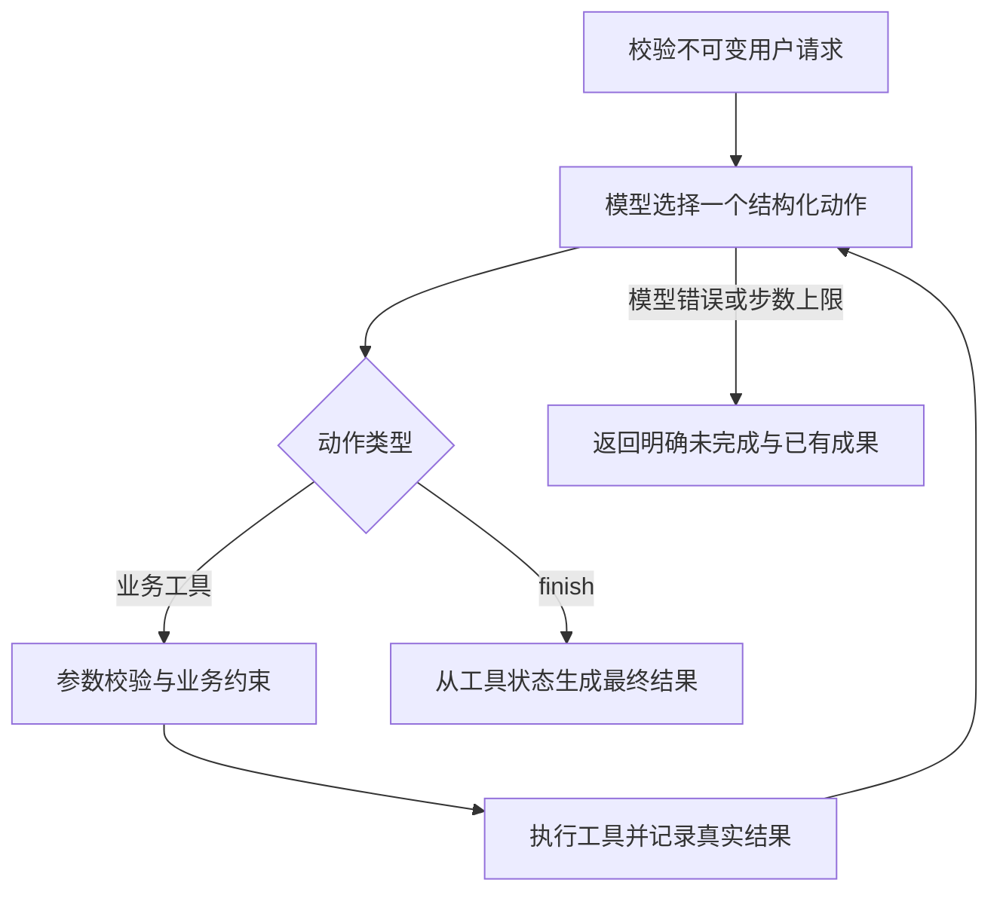

# 02 方案、动态决策与技术取舍

## 调用流程

每轮模型收到原始请求、截至当前的完整工具观察和剩余步数。它输出 action、arguments 和一句简短、可核对的 reason。程序校验后执行一个工具，将结果传给下一轮模型。模型选定下一步后，将动作写入前一条 Trace 的 next_action，形成连续决策记录。

可解析但不合协议的动作一律不执行，记录 invalid_action 并把校验错误作为 action_validation 观察反馈给模型。模型可修正下一步或停止；纠错占用同一总步数预算。无法解析的模型响应或网络错误仍明确返回 model_error，不自动切换 Mock。无效动作不计为业务工具调用。

输出格式采用 JSON 动作协议。真实模型逐步选择动作，观察工具执行结果后调整下一步；控制循环负责动作白名单、状态边界和步数预算。MockProvider 使用确定性分支，承担离线流程验证。

## 工具职责

| 工具 | 参数 | 真实作用与边界 |
| --- | --- | --- |
| read_material | source=primary 或 archive | 从合成资料读取或补全当前素材；模型不能填造字段 |
| check_rules | 无业务参数 | 基于必填字段、授权状态和风险标签生成审核结果 |
| query_slots | 无业务参数 | 查询当前频道的合成排期和数据库确认草稿 |
| save_draft | slot | 校验审核、查询及最新冲突；数据库事务保存或更新 |
| finish | 无业务参数 | 模型结束决策；程序按工具事实生成结果，不接受模型自报保存成功 |

所有动作参数统一包含可空的 source、slot；按动作严格校验用途，拒绝夹带无关参数、确认字段或发布动作。确认只来自可信 CLI 请求的 confirmed_slot。

## 已实现的动态路径

- 元数据完整 → 审核通过 → 查询原时段 → 保存 → 观察结果后结束。
- 缺少版权状态 → 补查归档 → 资料仍缺失则结束并列缺口；补齐则重新审核。
- 18:00 被占用 → 查询可用替代 → 保存 19:00 的待确认建议，保留原 18:00 要求。
- 查询暂时失败 → 模型观察失败后决定重试；保留已成功审核结果。
- 查询后时段被竞争占用 → 保存返回冲突 → 模型重新查询、调整建议后再次保存。
- 保存非暂时失败 → 模型观察失败后结束，最终状态保留失败事实。

模型根据观察选择执行顺序。例如从读取结果发现字段缺失后，可先补查再审核。验收核对最终业务结果和每步工具依据，支持不同的合法执行路径。

## 存储、确认与一致性

需求指纹对标准化后的 material_id、requested_slot、hard_requirement、confirmed_slot 计算 SHA-256。请求进入时即在事务中绑定请求 ID，包括之后失败的运行，防止同 ID 不同需求混写。确认通过新请求修订表达，使用新的请求 ID；原待确认草稿保留，自动归档列入后续迭代。

SQLite BEGIN IMMEDIATE、需求指纹主键和“频道 + effective_slot”唯一索引，共同约束重复和并发冲突。待确认草稿不持有 effective_slot，不预占资源。占用发生变化时，重复请求重新查询并更新同一草稿；不会新增第二份相同需求草稿。

审核和草稿保存 source_revision，绑定该素材主资料、归档及规则的内容摘要。每次操作和最终返回前检测变化；旧证明失效时标记 invalidated 并释放时段。读取归档仅补缺项，保留资料矛盾及全部风险信号；未知风险、无效字段不会直接通过。

最终状态由当前审核证明和数据库实际读回生成。save_status 是最新尝试，persisted_draft 是实际持久化内容；新尝试失败时 task_status/save_status 为 failed，同时保留旧草稿。finish 表示结束决策，保存结果由工具回执和数据库记录确定。达到步数上限返回 incomplete，并展示已有保存回执和持久化状态。

## 模型与依赖

采用 Python 标准库实现：urllib.request 负责 HTTP，sqlite3 负责事务，unittest 负责验证。DeepSeek 使用 Chat Completions 的 json_object 输出，客户端严格校验动作字段，运行记录保存动作及简短依据。可选 OpenAI 兼容适配器使用 json_schema；真实模型评估使用 DeepSeek，兼容入口覆盖接口契约测试。

接入依据：[DeepSeek JSON 输出](https://api-docs.deepseek.com/guides/json_mode/)、[Chat Completions 接口](https://api-docs.deepseek.com/api/create-chat-completion/)、[OpenAI 工具调用流程](https://developers.openai.com/api/docs/guides/function-calling)。模型与工具的多轮反馈由本项目运行器实现。
